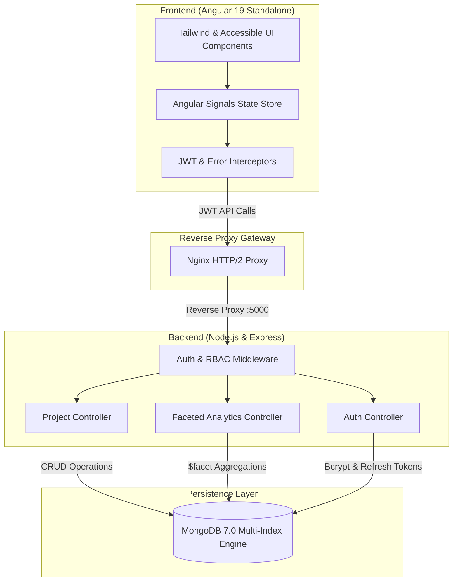

# FlowMatrix — Projects, Analytics & KPIs, Kanban Board

FlowMatrix is an enterprise resource hub built with the MEAN stack. It brings project management, analytics and key performance indicators (KPIs), and a Kanban board together in one application.

## Repository Structure

The structure and setup/build/test commands below describe a planned application; the frontend and backend workspaces and supporting files shown are not present in this checkout, so the commands are not currently runnable.

```text
flowmatrix/
├── backend/
│   ├── src/
│   │   ├── controllers/
│   │   ├── middleware/
│   │   ├── models/
│   │   ├── routes/
│   │   ├── services/
│   │   ├── tests/
│   │   ├── app.ts
│   │   └── server.ts
│   ├── .env.example
│   ├── jest.config.ts
│   ├── package.json
│   └── tsconfig.json
├── frontend/
│   ├── src/
│   │   ├── app/
│   │   │   ├── components/
│   │   │   ├── guards/
│   │   │   ├── interceptors/
│   │   │   ├── services/
│   │   │   ├── auth/
│   │   │   ├── app.routes.ts
│   │   │   ├── app.config.server.ts
│   │   │   └── app.routes.server.ts
│   │   ├── app.component.ts
│   │   ├── app.config.ts
│   │   ├── main.ts
│   │   ├── main.server.ts
│   │   ├── server.ts
│   │   └── tests/
│   ├── angular.json
│   └── package.json
├── docker-compose.yml
└── README.md
```

The frontend keeps Angular components, auth pages, guards, interceptors, services, and the standalone route list in `frontend/src/app/`; application bootstrap and the root component live directly under `frontend/src/`. `frontend/src/app.config.ts` registers routes from `frontend/src/app/app.routes.ts`. The backend keeps API code and tests under `backend/src/`. Supporting lockfiles, TypeScript settings, styles, assets, and SSR test files remain alongside their respective workspaces.

## Development

Install frontend dependencies and start the Angular application:

```bash
npm --prefix frontend install
npm --prefix frontend start
```

In a separate terminal, install backend dependencies, copy the safe environment template, edit `backend/.env` with local settings, and start the API:

```bash
npm --prefix backend install
cp backend/.env.example backend/.env
openssl rand -base64 32
openssl rand -base64 32
npm --prefix backend run build
npm --prefix backend start
```

Set the two generated values as distinct `JWT_ACCESS_SECRET` and `JWT_REFRESH_SECRET` values in `backend/.env`. Do not commit this local file.

The API listens on port `5000` by default and requires MongoDB. Angular proxies `/api` requests to `http://localhost:5000` through `frontend/proxy.conf.json`; this proxy is for local development only. The SSR server accepts `localhost` and `127.0.0.1` by default; configure trusted production hostnames in `frontend/angular.json`. The compose file is present but is not documented as a runnable deployment configuration because its referenced container setup is incomplete.

## Build and Tests

- `npm --prefix frontend run build` builds the Angular browser and SSR bundles.
- `npm --prefix frontend test` runs Angular component and HTTP service tests.
- `npm --prefix frontend run test:ssr` checks SSR host validation after a frontend build.
- `npm --prefix backend run build` compiles the API into `backend/dist`.
- `npm --prefix backend test` runs the Jest API, model, route, server, and in-memory MongoDB integration tests.

## System Architecture


    Interceptors -->|Bearer JWT / API Calls| Nginx
    Nginx -->|Reverse Proxy :5000| AuthMid
    ProjCtrl -->|CRUD Operations| Mongo
    AnalytCtrl -->|\$facet Aggregations| Mongo
    AuthCtrl -->|Bcrypt & Refresh Tokens| Mongo
